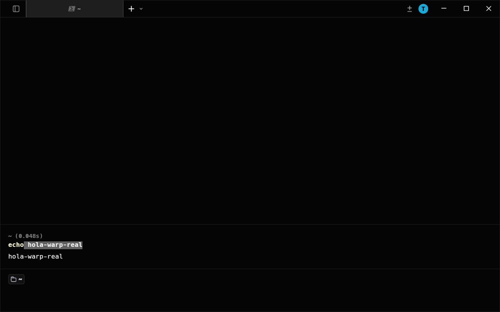

# warp-lite

A personal, minimal terminal built on Warp's real UI.

warp-lite is a fork of [Warp OSS](https://github.com/warpdotdev/warp) at `a4ad25c41`. It keeps the parts that make Warp a good terminal — the tab bar, blocks, input editor, completions, themes, keybindings, splits and the GPU renderer — and removes the product surfaces we don't use: Warp's own agent, Oz, Warp Drive, cloud sync, login, telemetry, notebooks, voice, MCP, code editor/diff, file tree, LSP, computer use and auto-update.



The UI is not reimplemented. It is the real `app/` UI, pruned from the inside. AI, Drive, cloud and telemetry are currently disabled through `warp-lite/settings.toml`; code and crate pruning is in progress.

## Status

Early. The base builds on Windows and matches the target UI. The `warp-lite` binary uses the OSS channel with its own application ID (`dev.warp.WarpLite`) and config directory, so it does not share settings or state with `warp-oss`.

| Metric | Warp OSS | Target |
|---|---:|---:|
| Window (warm) | 96 ms | <100 ms |
| Shell ready | 388 ms | <150 ms |
| RAM, 1 tab | 336 MB | <150 MB |
| Binary | 337 MB | <30 MB |
| Throughput, 19 MB | 1.4 MB/s | >20 MB/s |

See [`warp-lite/notes/`](warp-lite/notes/) for the measurements and the reasoning.

## Build

Requirements: Windows, Rust 1.92 (pinned by `rust-toolchain.toml`), MSVC Build Tools, CMake, protoc, LLVM/libclang and Git LFS.

```powershell
powershell -ExecutionPolicy Bypass -File .\warp-lite\build.ps1 -CheckOnly
powershell -ExecutionPolicy Bypass -File .\warp-lite\build.ps1
powershell -ExecutionPolicy Bypass -File .\warp-lite\run.ps1
```

Manual build:

```powershell
cargo build --release --bin warp-lite --features "gui,skip_login"
.\target\release\warp-lite.exe
```

Do not use `--no-default-features`: it changes the input to the universal variant and removes the agent button bar, so the UI no longer matches the target.

## What we keep

Terminal, blocks, tabs, input editor, completions, syntax highlighting, themes, keybindings, splits, scrollback, and running external CLI agents (Claude Code, OpenCode, Codex) as normal commands.

## What we remove

Warp's agent/Oz/agent mode, Warp Drive/cloud/login/collaboration, onboarding, notebooks, voice, MCP, code editor/diff, file tree, LSP, computer use, auto-update and factories.

## Layout

- `app/`, `crates/` — the Warp fork.
- `warp-lite/` — build/run scripts, settings, docs and notes.
- `warp-lite/notes/` — phase reports, benchmarks and screenshots.

## License

warp-lite is a fork of Warp. The `warpui` and `warpui_core` crates are MIT; the rest of the repository is AGPL-3.0-only. See `LICENSE-AGPL` and `LICENSE-MIT`.

Warp is a trademark of Denver Technologies, Inc. This project is not affiliated with, endorsed by or sponsored by Warp.
